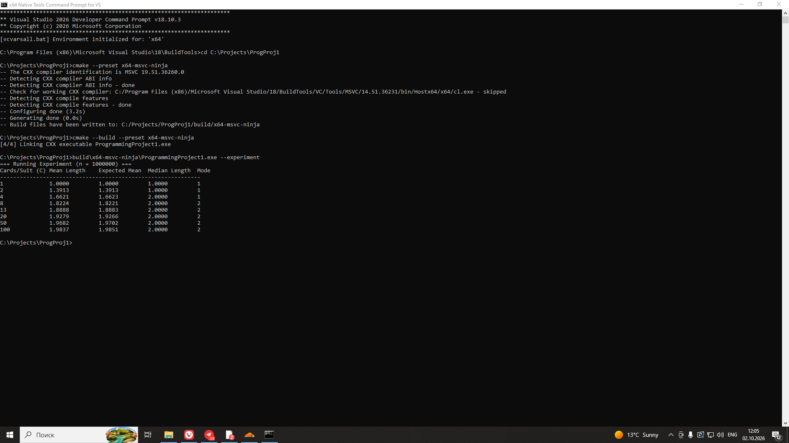
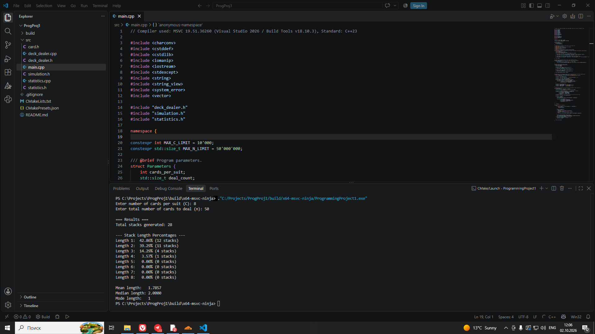
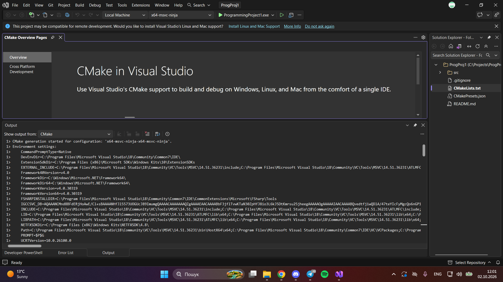
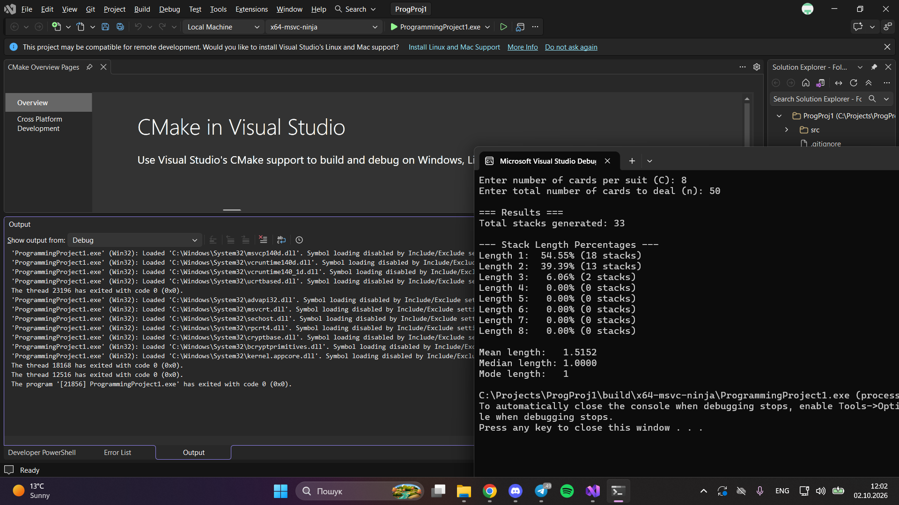

# Програмний проєкт №1 (задача 4)

Засоби функціонального програмування мови C++. Анонімні функції та функціональні
об'єкти. Three-way comparison.

**Автори:** Корпачов Артем Андрійович, Гнидка Дем'ян Євгенійович.
Група К-27, 2 курс, факультет комп'ютерних наук та кібернетики КНУ імені Тараса
Шевченка, спеціальність F3 «Комп'ютерні науки», освітня програма «Інформатика».
Дисципліна: «Програмування мовою C++. Додаткові розділи».

## Умова

Клас функціональних об'єктів `DeckDealer` роздає колоду карт: 4 масті, у кожній
по `C` карт (`C` задається). Колода тасується на початку, далі `operator()`
повертає чергову карту; коли колоду вичерпано, вона перемішується заново.

Роздається `n` карт. Поки наступна карта **строго старша** за попередню, вона
кладеться в поточну стопку. Якщо карта молодша або такої самої вартості —
стопка завершується й починається нова. Для отриманих стопок виводяться:
відсоток стопок кожної потенційної довжини (від 1 до `C`), найчастіша довжина
(мода), середня та медіанна довжини. Карти порівнюються лише через
`operator<=>`. Додатково досліджено залежність середньої та медіанної довжини
від `C` (програмний експеримент).

## Вимоги до збирання

* Стандарт **C++23**, компілятор **MSVC 19.51.36260** (Visual Studio 2026 /
  Build Tools v18.10.3). Те саме вказано в коментарі на початку `src/main.cpp`.
* CMake 3.25+, генератор Ninja, архітектура x64.

## Збирання

### VS Code (Developer Command Prompt)

1. Відкрийте **x64 Native Tools Command Prompt for VS 2026**. На початку консолі
   має бути рядок `Environment initialized for: 'x64'`.
2. Перейдіть до теки проєкту, налаштуйте та зберіть:

   ```bat
   cd C:\Projects\ProgProj1
   cmake --preset x64-msvc-ninja
   cmake --build --preset x64-msvc-ninja
   ```

   У виводі конфігурації має бути шлях із `Hostx64/x64/cl.exe` — це підтверджує
   64-бітний компілятор.

### Visual Studio

`File → Open → Folder…` і оберіть теку проєкту. Конфігурація `x64 MSVC with Ninja`
береться з `CMakePresets.json`. Збирайте через `Build → Build All`. Програму
зручніше запускати з терміналу (див. нижче), бо їй потрібні аргументи.

## Запуск і формат вхідних даних

Вхідних файлів немає: умова задачі їх не передбачає. Параметри задаються
аргументами командного рядка або в діалозі.

| Запуск | Дія |
| --- | --- |
| `ProgrammingProject1.exe` | Інтерактивний режим: програма запитає `C` та `n`. |
| `ProgrammingProject1.exe <C> <n>` | Одна роздача. Приклад: `ProgrammingProject1.exe 8 50`. |
| `ProgrammingProject1.exe --experiment` | Експеримент для `C` = 1, 2, 4, 8, 13, 20, 50, 100 при `n` = 1 000 000. |

Формат: десяткові цілі числа без пробілів, знака «+» та дробової частини.
Допустимі межі (захист від надмірної пам'яті й часу):

* `1 ≤ C ≤ 10000` — кількість карт у кожній масті;
* `1 ≤ n ≤ 50 000 000` — кількість карт для роздачі.

Некоректні дані (не число, зайві символи, число поза межами, хибна кількість
аргументів, обрив введення) дають повідомлення `[Error] ...` у `stderr` і код
завершення `1`; аварійного завершення немає. Успішний запуск повертає `0`.

## Приклад роботи

```bat
build\x64-msvc-ninja\ProgrammingProject1.exe 8 50
```

```text
=== Results ===
Total stacks generated: 32

--- Stack Length Percentages ---
Length 1:  53.12% (17 stacks)
Length 2:  40.62% (13 stacks)
Length 3:   3.12% (1 stacks)
Length 4:   3.12% (1 stacks)
Length 5:   0.00% (0 stacks)
Length 6:   0.00% (0 stacks)
Length 7:   0.00% (0 stacks)
Length 8:   0.00% (0 stacks)

Mean length:   1.5625
Median length: 1.0000
Mode length:   1
```

Через випадкове тасування результати окремих запусків відрізняються.

## Алгоритм і прийняті рішення

* Стопка триває **через межу колод**: після вичерпання колоди роздача
  продовжується, і остання карта старої колоди порівнюється з першою картою
  нової.
* Карта, **рівна** за вартістю попередній, завершує стопку (умова: «молодша або
  такої самої»).
* **Остання стопка**, обірвана на `n`-й карті, теж враховується, тому сума
  довжин усіх стопок дорівнює `n`.
* Вартості в стопці строго зростають, тож її довжина не перевищує `C`. Замість
  зберігання довжин усіх стопок (сотні мегабайтів при `n = 5·10⁷`) клас
  `LengthHistogram` рахує, скільки стопок має кожну довжину `1..C`. Пам'ять
  залежить лише від `C`, а середню, медіану й моду видно прямо з цих лічильників
  без сортування.
* Мода при рівності частот — найменша довжина.
* Генератор `std::mt19937` ініціалізується через `std::seed_seq` із 256 біт
  `std::random_device` (одного 32-бітного значення замало для його стану).

## Результати програмного експерименту

```bat
build\x64-msvc-ninja\ProgrammingProject1.exe --experiment
```

```text
=== Running Experiment (n = 1000000) ===
Cards/Suit (C) Mean Length    Expected Mean  Median Length  Mode
-------------------------------------------------------------
1              1.0000         1.0000         1.0000         1
2              1.3909         1.3913         1.0000         1
4              1.6620         1.6623         2.0000         1
8              1.8217         1.8221         2.0000         2
13             1.8892         1.8883         2.0000         2
20             1.9276         1.9266         2.0000         2
50             1.9680         1.9702         2.0000         2
100            1.9852         1.9851         2.0000         2
```

**Очікувана середня довжина.** Нова стопка починається, коли пара сусідніх карт
не є зростанням, тому при великому `n` середня довжина дорівнює `1/p`, де `p` —
імовірність такої пари. У межах колоди дві різні карти мають однакову вартість
з імовірністю `3/(4C−1)`, на стику колод (частка стиків `1/(4C)`) — з
імовірністю `1/C`. Звідси `p = (4C² + 3C + 1) / (8C²)` і

```text
середня довжина = 8C² / (4C² + 3C + 1)
```

Експериментальні значення відрізняються від неї на кілька тисячних, що
відповідає статистичній похибці при `n = 10⁶`.

**Висновок.**

* Середня довжина зростає разом із `C` і прямує до **2**: при великих `C`
  рівні карти трапляються рідко, тож пара сусідніх карт із імовірністю майже
  `1/2` є зростанням.
* При `C = 1` усі карти однакові, зростання неможливе, тому всі стопки мають
  довжину 1 (середня, медіана й мода дорівнюють 1).
* У наведеному запуску медіана дорівнює 1 для `C ≤ 2` і 2 для перевірених
  `C ≥ 4`, мода — 1 для `C ≤ 4` і 2 для перевірених `C ≥ 8`. Для малих `C`
  частки довжин 1 і 2 близькі, тому мода й медіана там чутливі до випадкових
  коливань між запусками.

## Скріншоти

### Корпачов Артем Андрійович

Збирання:



Робота програми:



### Гнидка Дем'ян Євгенійович

Збирання:



Робота програми:



## Розподіл обов'язків

* **Корпачов А. А.** — розробка предметної області та генерації даних: створення структури `Card` із перевантаженням тристороннього оператора порівняння (`operator<=>`) та розробка класу-функтора `DeckDealer` (робота з `<random>` і `std::ranges::shuffle` для ініціалізації та тасування колоди).

* **Гнидка Д. Є.** — розробка алгоритму підрахунку стопок (шаблон у `simulation.h`), створення класу `LengthHistogram` і модуля `statistics` для обчислення статистичних метрик та теоретичного очікування, реалізація CLI-інтерфейсу в `main.cpp` (безпечний парсинг через `std::from_chars`, обробка винятків), проведення програмного експерименту та підготовка README.

## Структура проєкту

```text
ProgProj1/
├── .gitignore
├── CMakeLists.txt
├── CMakePresets.json
├── README.md
├── screenshots/
└── src/
    ├── card.h            структура Card та operator<=>
    ├── deck_dealer.h     клас функціональних об'єктів DeckDealer
    ├── deck_dealer.cpp
    ├── simulation.h      підрахунок стопок (шаблон count_stacks)
    ├── statistics.h      LengthHistogram: середня, медіана, мода
    ├── statistics.cpp
    └── main.cpp          аргументи, діалог, вивід, експеримент
```

## Використані засоби C++

* **Власний клас функціональних об'єктів:** `DeckDealer` (`operator()`).
  Шаблон `count_stacks` приймає будь-який виклик, що повертає `Card`.
* **Анонімна функція (лямбда):** `[&device] { return device(); }` у
  `make_seeded_engine` заповнює дані для зерна генератора.
* **Бібліотечний функціональний об'єкт:** `std::less<>{}` у
  `std::ranges::max_element` (пошук моди).
* **`operator<=>`:** `Card::operator<=>` повертає `std::strong_ordering`;
  порівняння карт у `count_stacks` виконується як `std::is_gt(current <=> previous)`.
* **`<random>`:** `std::random_device`, `std::seed_seq`, `std::mt19937`,
  `std::ranges::shuffle`.
* **Обробка помилок:** винятки `std::invalid_argument`, `std::out_of_range`,
  `std::logic_error`; контейнер `std::vector` (RAII).
